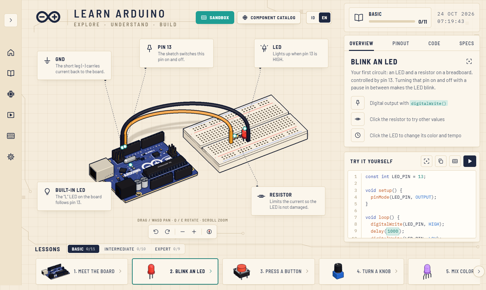
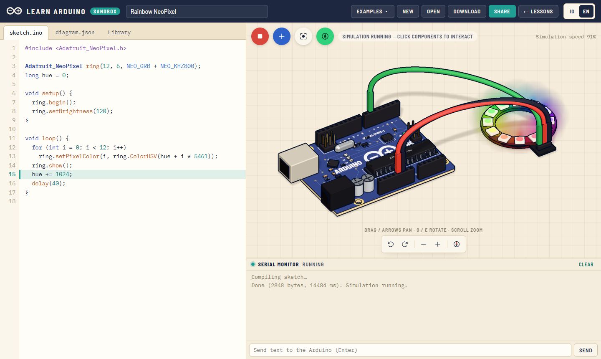
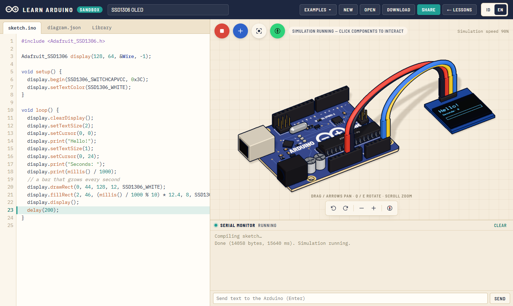
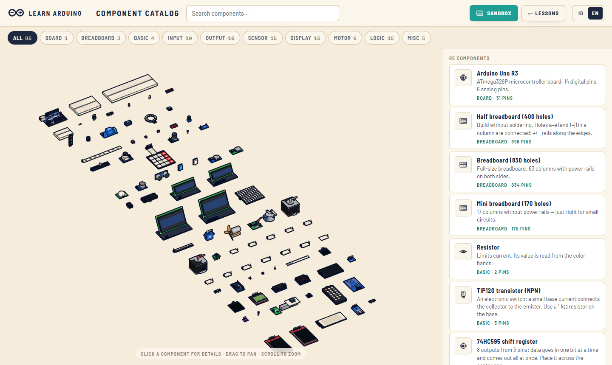
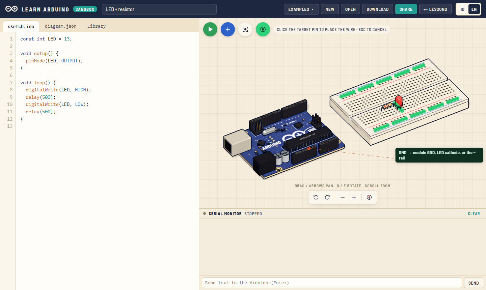
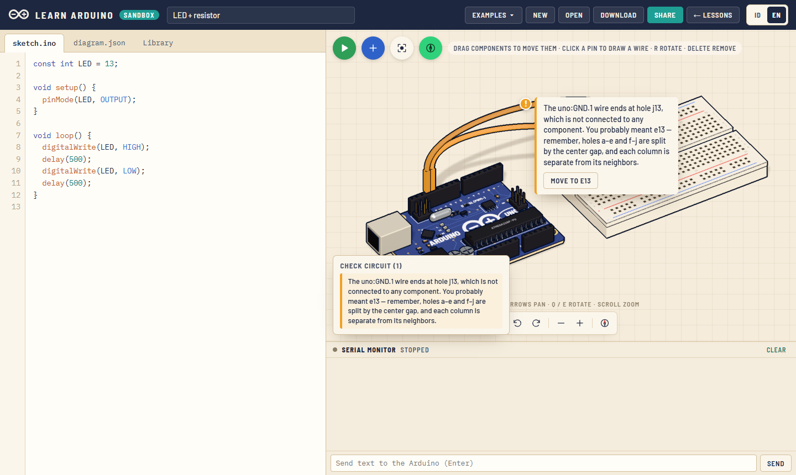

<div align="center">

# Learn Arduino

**An interactive 3D Arduino course and a browser-based circuit sandbox — real C++ compiled with `arduino-cli`, running on an ATmega328P emulator.**

**English** · [Bahasa Indonesia](README.id.md)

[](https://learn-arduino-id.vercel.app)
[](CHANGELOG.md)
[](LICENSE)




</div>

## Overview

Learn Arduino teaches electronics the way you would learn it on a real desk: a 3D board you can
rotate, parts you can click, and code you can change and run. When you are ready, the **sandbox**
lets you build your own circuits from 85 components and run real Arduino sketches in the browser —
no hardware and no installation needed.

| | |
|---|---|
| **30 lessons** | Basic (11), Intermediate (10), Expert (9): from blinking an LED to interrupts, EEPROM, state machines, and NeoPixels |
| **Sandbox** | 85 components, 38 example projects, real compilation with 27 Arduino libraries, two-way Serial Monitor |
| **Wire guide** | Highlights where a wire should go and explains what is wrong when it is not |
| **Component catalog** | Every part in 3D with its pins, settings, and a one-click "Try in sandbox" |
| **Two languages** | Indonesian and English across the whole site, including lessons and example code |
| **Accounts** | Optional Google sign-in to keep sandbox projects and lesson progress in the cloud |
| **AI circuit builder** | Describe a project in plain words; the AI picks parts, wires them, and writes the sketch — compiled and wire-checked before you see the preview |

## Live site

**https://learn-arduino-id.vercel.app**

| Page | What it is |
|---|---|
| [`/`](https://learn-arduino-id.vercel.app) | The 30 interactive lessons |
| [`/sandbox.html`](https://learn-arduino-id.vercel.app/sandbox.html) | Build a circuit and run real C++ on the emulator |
| [`/gallery.html`](https://learn-arduino-id.vercel.app/gallery.html) | Catalog of all 85 components |

## Features

### Interactive lessons

- A 3D Arduino Uno with callouts for every important part; drag to pan, rotate, and zoom.
- Each lesson has an overview, pinout, code, and specs, plus parameters you can change
  (resistor value, LED color, blink speed, …) and see the result immediately.
- Lessons can be opened in the sandbox with an equivalent circuit and the same code.

### Circuit sandbox



- Place components from 10 categories (boards, breadboards, inputs, sensors, displays, motors,
  logic, …); breadboard parts snap into the holes and move with the breadboard.
- Click a pin, then another pin, to draw a wire; drag a selected wire's ends to move them.
- **Run** compiles `sketch.ino` with `arduino-cli` on the server and runs the `.hex` on
  [avr8js](https://github.com/wokwi/avr8js): timers/PWM, ADC, USART, I²C, SPI, EEPROM, and
  device models such as HD44780 and I²C LCDs, SSD1306 OLED, ILI9341 TFT, WS2812, DHT22,
  HC-SR04, servos, steppers, an SD card, and more.
- The line being executed is highlighted in the editor; the Serial Monitor works both ways.
- Projects are saved in the browser; download/open them as `.json` or share them as a link.

<table>
  <tr>
    <td width="50%"></td>
    <td width="50%"></td>
  </tr>
  <tr>
    <td align="center"><sub>SSD1306 OLED over I²C</sub></td>
    <td align="center"><sub>Component catalog</sub></td>
  </tr>
</table>

### Wire guide

Beginners often know which parts they want but not where each wire should go. The wire guide
uses rules from the Arduino Uno documentation and component datasheets:

- **While drawing a wire**, matching destinations light up in green with a short hint
  (for example, *GND → module GND, LED cathode, or the − rail*).
- **After a wire is placed**, mistakes turn the wire orange (not quite right) or red (dangerous)
  with a **!** marker that explains the problem and offers a one-click fix — for example a GND wire
  that landed across the breadboard's center gap, I²C on the wrong pins, a servo on a non-PWM pin,
  an LED without a resistor, or 5V shorted to GND.
- It never blocks you, and it stays quiet about circuits that are simply not finished yet.

<table>
  <tr>
    <td width="50%"></td>
    <td width="50%"></td>
  </tr>
  <tr>
    <td align="center"><sub>Suggested destinations while wiring</sub></td>
    <td align="center"><sub>A misplaced wire with a suggested fix</sub></td>
  </tr>
</table>

### AI circuit builder

Anyone can describe what they want — *"an automatic soil-moisture monitor that shows the
value on an LCD"* — and the AI builds it in the sandbox: it picks components from the catalog, wires
them, and writes the sketch. Our own code then lays the parts out on the breadboard, checks every
wire with the wire-guide rules, and compiles the sketch; the AI gets one chance to fix anything that
fails. You see a 3D preview with the parts, code, and any substitutes, then **Accept** or **Reject**.
It can also modify the open circuit, with an **Undo AI changes** button. Components the catalog
lacks are reported to the admin.

**Bring your own key.** The AI runs on *your* API key — stored only in your browser and sent straight
from your browser to the provider, never to this site's server. Supported: **Google Gemini** (free
key from [Google AI Studio](https://aistudio.google.com/apikey)), **OpenRouter**, **Groq**,
**Anthropic (Claude)**, or any OpenAI-compatible address. No sign-in needed. A site owner can also
enable an optional **free site allowance** (server-side key, sign-in and a daily quota).

### Accounts (optional)

Signing in with Google (Supabase) adds features without taking anything away from guests:
sandbox projects saved to your account, lesson progress synced across devices, and an admin page
for the site owner. Data access is enforced with Postgres Row Level Security.

## Tech stack

| Area | Tools |
|---|---|
| Front end | [Vite](https://vite.dev), [Three.js](https://threejs.org), plain JavaScript (no UI framework) |
| Simulation | [avr8js](https://github.com/wokwi/avr8js) + a custom netlist and voltage solver |
| Compilation | [arduino-cli](https://arduino.github.io/arduino-cli/) with the AVR core and 27 libraries, as a Vercel function |
| Accounts | [Supabase](https://supabase.com) (Google OAuth, Postgres, Row Level Security) |
| AI | Bring-your-own-key from the browser (Gemini, OpenRouter, Groq, Claude via the [Anthropic SDK](https://github.com/anthropics/anthropic-sdk-typescript), OpenAI-compatible) plus an optional server allowance (Anthropic / Amazon Bedrock / OpenAI-compatible), all with structured JSON output |
| Tests | `node --test`, with [PGlite](https://pglite.dev) for the database schema and policies |
| Hosting | [Vercel](https://vercel.com) |

## Getting started

Requirements: **Node.js 20.19+** (developed on Node 24).

```bash
npm install
npm run setup:arduino   # once: downloads arduino-cli, the AVR core and libraries into tools/
npm run dev             # http://localhost:5173
```

| Command | What it does |
|---|---|
| `npm run dev` | Dev server with the `/api/compile` endpoint built in |
| `npm test` | Unit tests: netlist, wire guide, accounts, database schema & RLS |
| `npm run build` | Production build into `dist/` |
| `npm run vercel-build` | Build used on Vercel (installs and slims a Linux toolchain) |

Without `setup:arduino` the lessons still work, but the sandbox cannot compile sketches.

To enable accounts, copy `.env.example` to `.env.local` and fill in your Supabase URL and anon
key. During development, `?fakeauth=1` or `?fakeauth=admin` uses in-memory test accounts instead.

## How the simulation works

```
sketch.ino ──POST /api/compile──▶ arduino-cli ──▶ .hex + address→line map (DWARF)
                                                   │
browser: avr8js (CPU, timers/PWM, ADC, USART, I²C, SPI, EEPROM)
           ⇅ port hooks / PIN reads / ADC
         sim/netlist.js + sim/circuit.js — wires, breadboard strips, voltage solver
           ⇅
         sim/devices*.js — behavior of each component (LED, servo, LCD, OLED, TFT, …)
```

## Project structure

```
index.html · sandbox.html · gallery.html · admin.html
api/compile.js          Vercel function: compiles sketches
server/                 arduino-cli wrapper (cache, queue, DWARF line map) + standalone server
supabase/migrations/    Database schema and Row Level Security policies
src/
  lessons/              The 30 lessons
  components/           Specs for the 85 sandbox components (model, pins, props, behavior)
  parts/                3D models built in code (units: mm)
  sim/                  Emulator glue, netlist, voltage solver, device models, wire-guide rules
  sandbox/              Sandbox app, workbench, examples, catalog
  account/              Sign-in, cloud projects, progress sync
  admin/                Admin page
  i18n/                 Indonesian and English text
tests/                  node --test suites
```

## Documentation

- **[Developer guide](docs/PANDUAN-PENGEMBANG.md)** (Indonesian): how the simulation and wire guide work,
  deploying to Vercel, setting up accounts, adding lessons and components.
- **[Changelog](CHANGELOG.md)** — what changed in each version.

## Deployment

The project deploys to Vercel as a static site plus one function (`api/compile.js`) that ships a
slimmed Linux toolchain (about 200 MB, below Vercel's 250 MB function limit).

```bash
npx vercel deploy --prod
```

Account setup (Google provider, database migration, environment variables) is described step by
step in the [developer guide](docs/PANDUAN-PENGEMBANG.md#akun--data).

## License

Released under the [MIT License](LICENSE).

## Credits

The design is inspired by [Learn Arduino](https://learn-arduino-red.vercel.app/) by Dilum Sanjaya.
The code, 3D models, and lesson text in this repository were written from scratch. The emulator
is [avr8js](https://github.com/wokwi/avr8js) by Wokwi.
